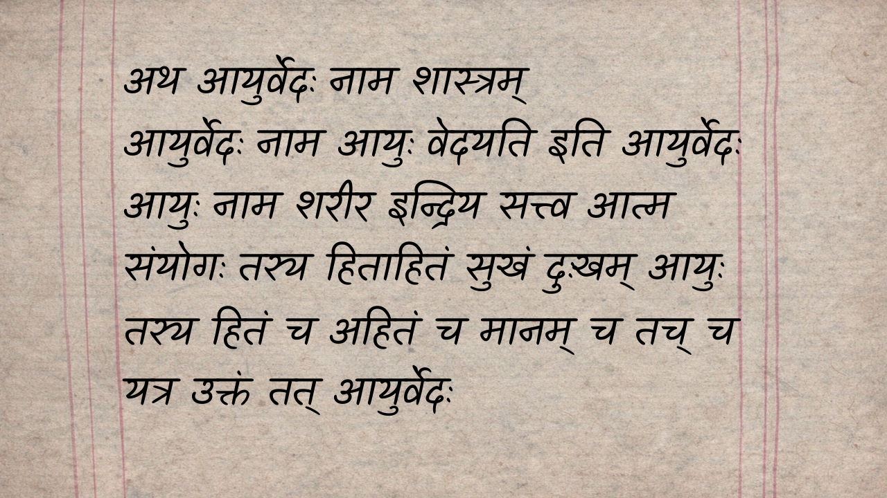
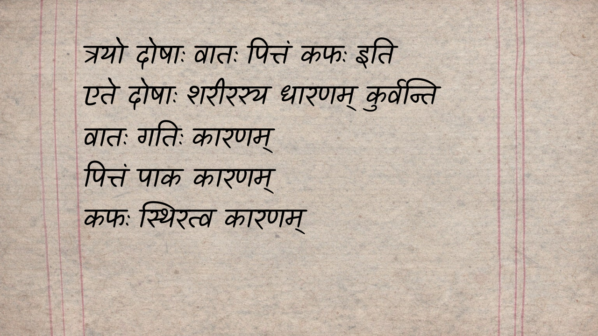
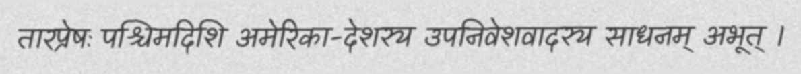
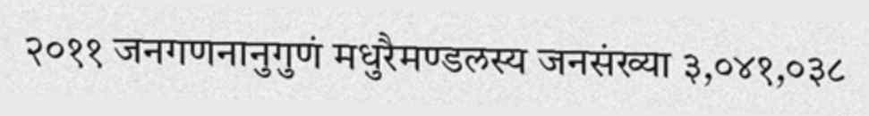
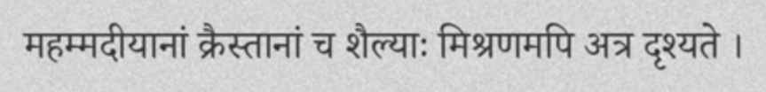
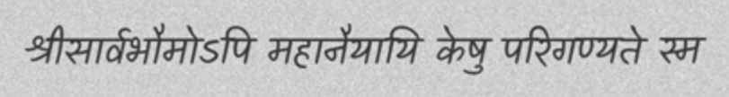
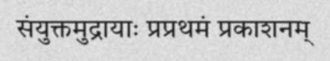
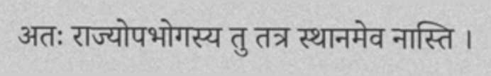

# Report: Post-OCR Correction for Sanskrit / Devanagari

**Track:** Option 3, Post-OCR Correction Model for Sanskrit/Indic Text
**Model:** `google/byt5-small`, fully fine-tuned (final = `checkpoint-1600`) · **Hardware:** Google Colab T4 (16 GB)

**Links**
- Trained model (Hugging Face, public): https://huggingface.co/MrunalYewatkar45/byt5-small-sanskrit-post-ocr
- Code, data and all results (GitHub): https://github.com/Mrunal31-Stark/OCR_Extraction_indic_text
- Notebook with outputs: `notebooks/Sanskrit_Post_OCR_Correction.ipynb` · Setup instructions (Colab and local): [`README.md`](README.md#setup)

> **Training status (please note):** I stopped training early, at **step 1,768 of 2,125 (83% of one epoch)**, because the **Google Colab GPU runtime kept disconnecting** during the run. Training was resumed once after a disconnect, from `checkpoint-400`, and the runtime dropped again several times. Rather than lose more time to resets, I used the best checkpoint saved so far, **`checkpoint-1600`** (dev CER 5.2%). The dev curve was still falling (7.8% → 7.0% → 5.7% → 5.2%), so **all results below are for a partly trained model**. Finishing the epoch, about 30 more minutes on a T4, would likely improve them a little. See §4 and §8.

## Results at a glance
| Test set | CER before → after | WER before → after | Notes |
|---|---|---|---|
| **Real page images** (5 pages, 705 chars) | **9.6% → 8.2%** (beam 4: **7.7%**) | 33.9% → 32.2% | 95% CI: [7.4–12.5] → [6.4–10.9], overlapping |
| **Our noisy images** (500 rendered lines + real Tesseract) | **8.8% → 7.4%** | 32.6% → 27.8% | 95% CI: [8.0–9.7] → [6.7–8.2]; Kalam font: 15.2% → 12.2% |
| Synthetic rule noise (1,000 lines) | **7.4% → 3.4%** | 36.0% → 18.5% | 95% CI: [7.0–7.8] → [3.2–3.7]; 30% of broken lines fully restored |

All numbers, per-line predictions and data splits are in the repo: `results/metrics.json`, `results/predictions_*.jsonl`, `datasets/`.

**In one line:** the corrector more than halves the errors on noise like its training data. On real Tesseract output the gain is **15–20%**, and on just 5 pages that isn't statistically conclusive. It also changes **11% of lines that were already correct** (over-correction). The gap between synthetic and real errors, together with over-correction, is the main finding and the main thing to fix next (see §7, §9).

---

## 1. Problem understanding
OCR engines struggle with Sanskrit in Devanagari script. Glyphs look alike (य/म, व/ठ), vowel signs and the marks above and below a letter are easy to miss, conjuncts (stacked half-letters) break apart, and old print adds noise. The goal is a model that takes **raw OCR text** and returns **corrected text**.

Three properties of the task drove the design:
- **Copy-mostly.** About 90% of characters are already right, so a good corrector must change *only* what's wrong. Over-correction (rewriting correct text) is this task's form of hallucination and the main risk.
- **Character-level, with context.** Most fixes are 1–3 code points, but some can only be decided from the sentence. In *real-word errors*, OCR produces another valid word: रोगः (disease) → योगः (yoga), दोष → द्रोण. A dictionary can't catch these.
- **Hardly any real labelled data.** We have 5 real page images with ground truth, so training data has to be synthetic and the real pages are kept for testing.

## 2. Dataset preparation
**Real test set (held out):** 5 scan-style page images of Ayurvedic Sanskrit with ground-truth text (`Data/`, 705 characters). We OCR'd them with Tesseract 5 (`san`, `--psm 6`, best of a 4-config grid):
**CER 9.6%, WER 33.9%.** This is the "before" number.

**Error analysis drove the data design.** We aligned OCR output to ground truth (51 edits: 38 substitutions, 8 deletions, 5 insertions):
- about 60% look-alike consonant swaps (य→म ×8, व→ठ/त/क/न, ह→द, स→य, ष→ण)
- about 25% mark errors (anusvara `ं`→`े` ×5, dropped visarga `ः` ×3, dropped or reduced vowel signs)
- about 10% conjunct errors (spurious `्र`: दोष→द्रोष; lost half-letters: त्त्व→त्व)
- real-word errors (रोगः→योगः, विहारः→निहार)

**Clean text:** Sanskrit Wikipedia (`wikimedia/wikipedia 20231101.sa`, 12k articles), NFC-normalized and cut into line-sized chunks of 3–10 words. We kept chunks that are ≥90% Devanagari and contain no Latin letters or digits, then removed duplicates. That left **436k clean lines**. Any chunk that shares a 3-word window with a test page was removed (none did).

**Two noise sources:**
1. **Rule-based noise (`src/noise.py`).** A confusion table of look-alike glyphs, mark drops and swaps, conjunct insertions and drops, plus spacing and danda noise, weighted by the error mix above. Noise level is drawn per line, and 10% of lines are left clean. *Calibration:* the synthetic edit mix (sub/del/ins) is **69/17/13** vs real **75/16/10**. Effective CER ≈ rate/2, so training covers roughly 1.5–20% CER.
2. **Render-then-OCR.** 6,000 clean lines drawn with PIL+raqm in 6 Devanagari fonts, then degraded with paper noise, blur, rotation, downscaling and JPEG compression. The **same Tesseract** reads them back, which gives real OCR errors without hand labelling. Tesseract is almost perfect on clean print fonts (CER 0–4%) but not on the handwriting-style **Kalam** (CER ~13–15%), whose style is close to the test pages. Half the renders use Kalam, which brings this set to **10.0% CER** with exactly the real confusions (व→ठ, य→म).

**Splits** (disjoint at the clean-line level; leakage checks are assertions in the notebook):

| split | n | do-nothing CER | already-correct lines |
|---|---|---|---|
| train (rule + render×2) | 67,984 | 7.4% | 24% |
| dev | 1,500 | 8.1% | 23% |
| test_rule | 1,000 | 7.4% | 23% |
| test_render | 500 | 8.8% | 31% |
| real pages | 5 pages | 9.6% | – |

**Unicode normalization:** both sides are NFC-normalized and ZWJ/ZWNJ are removed **before every metric**, so differences in Unicode encoding (e.g. a precomposed nukta letter vs letter + nukta sign) never count as errors. The model's output is NFC-normalized too.

## 3. Why ByT5-small
- **It works on bytes, so it has no vocabulary to fail on.** OCR output contains Latin look-alikes (`|`, `l`, `:`), stray marks and invalid vowel-sign sequences. A byte model can read and write any string, and a correction is a small byte-level edit.
- **We tested the tokenizer argument instead of assuming it.** On 1,000 dev lines, mT5's SentencePiece handled Devanagari *better than expected*: 0% `<unk>`, 99.9% exact round-trip, sensible splits (संयोगः → `▁सं|योग|ः`). A one-character OCR edit changes about 2 tokens for *both* models. So subword fragmentation turned out **not** to be a decisive problem. We still chose ByT5 because it's lossless by design (100% round-trip) and because of the ByT5 paper's reported robustness to noisy and misspelled input.
- **The cost is length:** ByT5 sequences are **6.3× longer** (2.79 tokens per character vs 0.44). That's the main compute cost on a T4 and the reason we trained for only one epoch. **mT5-small is the obvious cheaper ablation** (future work).
- **Why not an LLM (Llama-3.2-1B / Gemma-2B)?** They're much larger for a narrow copy-and-edit task. Decoder-only models also paraphrase more readily, which means more over-correction, and they'd need LoRA/QLoRA to fit on a T4.
- **Tokenizer adaptation:** none needed. ByT5 has no vocabulary, and mT5 showed 0% unknown tokens.

## 4. Fine-tuning approach
Full fine-tuning (300M parameters fit on a T4, so LoRA isn't needed) with the Hugging Face `Seq2SeqTrainer` (`src/train.py`):
- Input is the noisy line and the target is the clean line. `max_length=384` bytes (target p99 285, max 349, so nothing is truncated).
- Adafactor, learning rate 5e-4, linear decay with 3% warmup, effective batch 32 (8 × 4 gradient accumulation), **1 epoch = 2,125 steps**.
- Length-grouped batching (`train_sampling_strategy='group_by_length'`) to cut padding.
- Every 400 steps: evaluate on 300 dev lines **with real generated output** (CER/WER, not just loss) and save a checkpoint to Google Drive. The best checkpoint is kept by dev CER.
- Training is resumable: after a runtime reset, the script continues from the latest Drive checkpoint, including optimizer, scheduler and data position.

**Learning curve** (dev = 300 held-out lines, CER from generated output; doing nothing = 8.1%):

| step | 400 | 800 | 1,200 | 1,600 |
|---|---|---|---|---|
| training loss | 0.34 | 0.27 | 0.23 | 0.20 |
| dev CER | 7.8% | 7.0% | 5.7% | **5.2%** |
| dev WER | 31.0% | 29.7% | 26.3% | **24.6%** |

The model first learns to copy (step 400 is barely below doing nothing), then to correct. **Early stop because of Colab GPU disconnects:** the Google Colab GPU runtime disconnected repeatedly during training, so I stopped at step 1,768 of 2,125 and use **`checkpoint-1600`**, the best by dev CER. The curve was still going down, so the last ~17% of the epoch (at a learning rate already winding down) and further epochs would likely help a bit. Training can be finished from the saved checkpoint with the resume cell (README, Option C).

## 5. Hardware constraints and optimizations
| Constraint | Decision |
|---|---|
| T4 has no bf16, and T5 models overflow to NaN in fp16 | **fp32** training. The script switches to bf16 automatically on L4/A100 (`compute capability ≥ 8`) |
| Batch 16 × 384 bytes ran out of memory in fp32 (the longest batch comes first with length grouping) | Batch 8 × 4 gradient accumulation (same effective batch 32), `expandable_segments` allocator |
| Bytes make sequences 6× longer | Length-grouped batches, short line-level inputs, 1 epoch |
| Measured speed 1.85–3.3 s/step (2 epochs ≈ 2–3 h) | 1 epoch; more epochs under future work |
| Colab runtimes reset or disconnect | Checkpoints and data backups on Drive, resumable training, training run as a **detached process** |
| Rendering + OCR is CPU-bound (2 vCPUs) | Multiprocessing pool, resumable batches of 1,500 |

## 6. Evaluation methodology
- **Metrics:** CER and WER (`jiwer`) after NFC normalization, reported *before* (raw Tesseract) and *after* (corrected) on three test sets that were never trained on: the **5 real page images**, which is the result that matters most; **500 rendered-and-OCR'd line images** we created; and 1,000 lines with synthetic rule noise.
- **Over-correction rate:** the share of *already-correct* inputs the model changed. This is this task's hallucination metric.
- **Fully-fixed rate:** the share of broken lines restored exactly. **Made-worse rate:** lines whose CER went up.
- **Error-type breakdown:** remaining edits grouped as consonant / mark / conjunct / space-punct, before vs after.
- **Real pages:** 95% bootstrap confidence intervals, resampling the 20 aligned lines, because 705 characters is a tiny sample.
- **Decoding:** greedy vs beam search (4 beams). **By font** on the rendered set, to see how much the Kalam font-matching drives the result.
- **Sanity checks in the notebook:** an already-correct probe line must come back unchanged, and a reloaded checkpoint must give identical outputs (checking the tied-embedding warning).

### 6.1 Real page images (`Data/page_*.png`), before vs after
Tesseract `san` (`--psm 6`) → ByT5 corrector, line by line.

| Page | CER OCR → corrected | WER OCR → corrected |
|---|---|---|
| 1 | 12.1% → **6.6%** | 34.3% → 25.7% |
| 2 | 5.8% → 7.4% ✗ | 20.0% → 30.0% ✗ |
| 3 | 9.8% → 10.7% ✗ | 36.8% → 36.8% |
| 4 | 9.7% → 9.0% | 40.0% → 35.0% |
| 5 | 9.2% → 8.5% | 38.1% → 38.1% |
| **All (greedy)** | **9.6% → 8.2%** | **33.9% → 32.2%** |
| All (beam 4) | 9.6% → **7.7%** | |

Errors by type (all 5 pages): consonant 26 → 23 · conjunct 12 → 8 · mark 13 → **15**.

**Page 1**  

| | text |
|---|---|
| Ground truth | …आयुः **वेदयति** इति… संयोगः **तस्य** हिताहितं **सुखं** दुःखम् आयुः **तस्य** हितं च अहितं च… **यत्र** उक्तं तत् आयुर्वेदः |
| Tesseract | …आगुः **ठेट्रमति** इति… संयोगः **तस्त्र** हिताहितं **युखं** दृखम् आयुः **तस्त्र** हितं च अदितं च… **मत्र** उक्तं तत् आयुर्वेद |
| Corrected | …आगुः **वेटयति** इति… संयोगः **तस्य** ✓ हिताहितं **मुखं** दृखम् आयुः **तस्य** ✓ हितं च अदितं च… **यत्र** ✓ उक्तं तत् आयुर्वेद |

**Page 2**  

| | text |
|---|---|
| Ground truth | **त्रयो** दोषाः वातः पित्तं **कफः** इति एते दोषाः… **कफः** **स्थिरत्व** कारणम् |
| Tesseract | **त्रमो** द्रोषाः वातः पित्तं **कफः** इति एते द्रोणाः… **कफः** **स्थिरत्व** कारणम् |
| Corrected | **त्रयो** ✓ द्रोषाः वातः पित्तं **ककः** ✗ इति एते द्रोणाः… **ककः** ✗ **स्थिरत्वं** ✗ कारणम् |

Pages 3–5 are listed in full in the notebook (cell 4b). Highlights: ठर्धमति→**वर्धयति** ✓, धाठने→**धावने** ✓, व्मायामः→**व्यायामः** ✓, शरीरस→**शरीरस्य** ✓, वेषम्म→वेषम्य (half-fixed), but रोग→रोगं ✗, बल→बलं ✗, द्िनचर्मा→द्वितचर्मा ✗.

### 6.2 Noisy images we created (render → Tesseract → corrector)
**500 held-out rendered lines** (6 fonts, degraded scans, real Tesseract output):

| | CER | WER | fully fixed | over-correction | made worse |
|---|---|---|---|---|---|
| Tesseract → corrected | **8.8% → 7.4%** | 32.6% → 27.8% | 7% | 7.1% | 13.6% |

| Font | n | CER OCR → corrected |
|---|---|---|
| Kalam (handwriting-style, like the test pages) | 241 | **15.2% → 12.2%** |
| Tiro Devanagari Sanskrit | 55 | 3.6% → 4.0% |
| Yatra One | 45 | 2.9% → 3.1% |
| Lohit Devanagari | 49 | 2.1% → 2.2% |
| Noto Serif Devanagari | 58 | 1.9% → 2.1% |
| Noto Sans Devanagari | 52 | 1.9% → 1.9% |

Errors by type: consonant 616 → 435 · conjunct 329 → 261 · mark 312 → 304 · space/punct 84 → 63.

**Six new degraded images from held-out text** (`samples/`, never trained on):

| Image | Tesseract | Corrected | CER |
|---|---|---|---|
|  | …अमेरिका-**दरेशस्त्र उपनितेशताटसप्र** साधनम्… | …अमेरिका-**देशस्य** ✓ **उपनितेशनाटस्य** साधनम्… | 14.1% → **4.7%** |
|  | **२०१९** जनगणनानुगुणं… **३,०४९,०३८** | unchanged (digits can't be inferred from context) | 4.0% → 4.0% |
|  | correct | unchanged ✓ | 0% → 0% |
|  | श्रीसार्वभांमोऽपि **महानैमापि** केषु **परिगण्मते सख** | …महानैमापि केषु **परिगण्यते स्म** ✓ | 15.6% → **8.9%** |
|  | …प्रप्रथमं **प्रकाङनम्** | …प्रप्रथमं **प्रकाङ्गनम्** ✗ (should be प्रकाशनम्) | 2.8% → 8.3% ✗ |
|  | correct | unchanged ✓ | 0% → 0% |

### 6.3 Synthetic rule noise (1,000 held-out lines)
| | CER | WER | fully fixed | over-correction | made worse |
|---|---|---|---|---|---|
| noisy → corrected | **7.4% → 3.4%** | 36.0% → 18.5% | 30% | 13.7% | 6.8% |

Errors by type: consonant 1,495 → 540 (−64%) · conjunct 645 → 270 (−58%) · space/punct 128 → 69 · mark 351 → 313 (−11%).

### 6.4 What the numbers say
1. **The synthetic-to-real gap is the main bottleneck.** −54% CER on rule noise, but −16% on rendered images and −15% (greedy) / −20% (beam) on the real pages. The model learned *our* noise model well, and real Tesseract errors are only partly covered by it.
2. **It helps where OCR is bad and hurts slightly where OCR is already good.** Kalam goes 15.2% → 12.2%. Clean print fonts (about 2% CER) get very slightly worse. *Product implication:* only run the corrector on low-confidence OCR output.
3. **Consonant and conjunct errors get fixed; marks barely do** (−11% synthetic, worse on real pages). Anusvara vs ए-matra and visarga drops often give two valid forms, so they're truly ambiguous without wider context.
4. **Beam search helps on real pages** (8.2% → 7.7%), not on rendered lines. That's cheap to turn on for short pages.
5. **Real pages: the confidence intervals overlap** ([7.4–12.5] vs [6.4–10.9]). On 705 characters we can't claim a statistically solid improvement. A larger real test set is the first priority.

## 7. Failure cases (hallucination and error analysis)
**Over-correction: 43 of 388 already-correct lines (11%) were changed.** Almost all of them apply one of our *training* confusion pairs in reverse to rare words or proper nouns:

| Correct input | Model output | Pattern |
|---|---|---|
| आत्म**घा**तिरोगेण | आत्म**धा**तिरोगेण | घ→ध (confusion table is two-way) |
| …व्यतिरिक्ता**घ**नाशिनी | …व्यतिरिक्ता**ध**नाशिनी | घ→ध |
| नमदा**फा**-नदी | नमदा**का**-नदी | फ→क on a proper noun |
| विरच**य्य** | विरच**स्य** | rare form → common genitive ending |
| …खनीली**मा** | …खनीली**या** | म→य |
| कफः (real page 2, ×2) | **ककः** | फ→क on an Ayurvedic term rare in Wikipedia |

*Root cause:* the confusion table contains both directions (घ↔ध, क↔फ, य↔म), so for a rare word the model can't tell which side is the "real" one and falls back on what's more common in Wikipedia. Fixes: one-way confusions learned from real OCR, a domain lexicon, and confidence-gated edits (§9).

**Real-word errors: 0 of 3 fixed** on the real pages: योगः (should be रोगः), द्रोण (should be दोष), निहार (should be विहारः). All are valid words, and fixing them needs domain context (रोगः नाम दोष वैषम्य, "disease is imbalance of the doshas") that a model trained on Wikipedia doesn't have.

**Made worse: 13.6% of rendered lines.** Typical cases:
- partial fixes that introduce a new error (द्रढतया → द्रद्धतया)
- quote and bracket normalization
- anusvara added to correct words (रोग→रोगं, बल→बलं, स्थिरत्व→स्थिरत्वं). Our noise drops anusvara often, so the model learned to add it back too eagerly.

**Not fixable from the text alone:** digits (२०११→२०१९), heavily garbled words where Tesseract output is far from any real word (उपनितेशताटसप्र), and sandhi-merged long compounds.

**Biggest wins** (whole line restored exactly): य्रत् अस्भाफं ढेहस्य → **यत् अस्माकं देहस्य** · अम्मन ठर्षे इठलीदेशसथः → **अस्मिन् वर्षे इटलीदेशस्थः** · इति पयतिपाद्रयन्तः मन्नि → **इति प्रतिपादयन्तः सन्ति**.

## 8. Challenges encountered
- **Changed library APIs:** Colab ships `transformers` 5.x, where `warmup_ratio` was folded into `warmup_steps` (a float means a ratio) and `group_by_length` became `train_sampling_strategy`. We inspected the signatures instead of guessing and fixed both together.
- **Running out of GPU memory** on the first step. Length grouping deliberately puts the longest batch first, so we fixed it at the worst case with gradient accumulation.
- **Tesseract was too good on clean fonts:** naive rendering gave about 2% CER, which teaches little. We measured per font and weighted toward the font that produces realistic errors, and we report that as a possible source of optimistic results.
- **Notebook and runtime instability:** the first background launch (`!nohup … &`) stayed attached to the cell and blocked the notebook. After a browser reconnect, training stalled at step 400. Because checkpoints and data were on Drive, we resumed from `checkpoint-400` with no loss, using a properly detached `subprocess.Popen(start_new_session=True)`.
- **Repeated Colab GPU disconnects, the reason training stopped early:**
  - The first run stalled after `checkpoint-400` when the session dropped. I resumed from that checkpoint without losing work, because checkpoints and data lived on Google Drive.
  - The GPU runtime then kept disconnecting during the roughly 80-minute run. The detached training process survived some of these, but each one meant reconnecting and checking state.
  - I stopped training at step 1,768 of 2,125 and used the best saved checkpoint (1,600) rather than risk losing more time to another reset.
  - **Lesson:** on free Colab, plan for interruptions. Keep checkpoints frequent and on Drive, make training resumable, run it detached from the notebook, and use a paid or local GPU for runs longer than about an hour.
- **A bug in our own evaluation:** the first real-word-error check matched substrings and wrongly reported योगः as unfixed inside the correct word संयोगः. We switched to whole-word comparison.
- **The tokenizer hypothesis was wrong:** we expected mT5 to fragment Sanskrit badly, and measured that it doesn't. We kept ByT5 for other, stated reasons and documented the finding.

## 9. What we would improve with more time
1. **More realistic data:** classical corpora (GRETIL, DCS, Bhagavad Gita, Ayurvedic texts) instead of Wikipedia, real scanned pages with aligned text, and more fonts and degradations (bleed-through, broken glyphs).
2. **Correlated noise:** errors that cluster per word and per line, and confusion tables learned from OCR runs instead of written by hand.
3. **Ablations:** mT5-small vs ByT5-small (speed and quality), LoRA vs full fine-tuning, 1 vs 3 epochs, and with vs without render pairs.
4. **Fix the two failure modes we measured:** use one-way confusions and a lower anusvara-drop rate in the noise model (these drive most over-corrections), and add a domain lexicon (Ayurveda terms such as कफ) to the training text. Also complete the epoch and train 2–3 epochs; the dev curve was still falling.
5. **Confidence-gated correction:** apply an edit only when the model's confidence is high, using token log-probabilities or agreement between beams, to push over-correction toward zero.
6. **Page-level context:** correct with neighbouring lines as context to resolve more real-word errors. Add IAST/Roman transliteration noise.
7. **Deployment:** int8 quantization or ONNX for CPU inference, plus a simple OCR → correct → diff-view web demo for human review.
